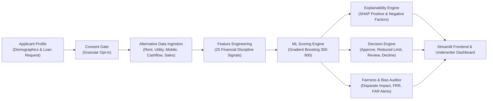

# 🎯 FairScore (InclusiScore)
### Alternative Credit Scoring for the Credit-Invisible
**Responsible, Explainable, Consent-Based AI Decision-Support for Thin-File Borrowers**

---

## 🌟 Executive Summary

Over 1.4 billion economically active individuals worldwide are excluded from formal credit because they lack a traditional credit bureau footprint (CIBIL/Experian), salary slips, or formal collateral. Traditional underwriting interprets an "absence of credit history" as high risk, rejecting reliable gig workers, small shopkeepers, freelancers, and first-time borrowers.

**FairScore** solves this problem by using **consented alternative financial signals**:
- 🏠 **Rent payment regularity & stability** (UPI/bank/cash receipts)
- 💡 **Utility bill discipline** (electricity, water, gas, broadband)
- 📱 **Mobile recharge regularity** (connectivity continuity & airtime usage)
- 💵 **Cash-flow volatility & balance buffers** (weekly gig deposits, positive balance days)
- 🏪 **Small business consistency** (daily turnover, customer retention, seasonality)

FairScore combines **Gradient Boosting Machine Learning**, **SHAP (SHapley Additive exPlanations)**, and a **Fairness & Bias Audit Engine** to turn invisible cash-flow reliability into an explainable, auditable credit decision.

---

## 🏗️ Architecture & Pipeline



---

## 🚀 Key Features

| Component | Capabilities |
| :--- | :--- |
| **Granular Consent Manager** | Explicit, purpose-limited consent per data category with verifiable audit receipt. Prevents score generation without minimum required data coverage. |
| **Alternative Feature Pipeline** | Transforms unstructured alternative signals into 25 normalized features: payment reliability, cash-flow stability, expense burden, business continuity, and data completeness. |
| **High-Precision ML Scoring** | Gradient Boosting Classifier achieving **AUC-ROC > 0.99** on synthetic data (note: inflated due to label circularity with features — see `docs/TECHNICAL_AUDIT.md`), calibrated to a 300–900 credit score with risk grades (A–E) and confidence indicators. |
| **SHAP Explainability** | Unpacks "black-box" predictions into top positive drivers (e.g. on-time rent, low volatility) and negative flags (e.g. high expense ratio, seasonal dips) with plain-language summaries. |
| **Fairness & Bias Audit Panel** | Real-time monitoring across Demographic Slices (Urban/Rural, Gender, Age, Occupation, Region). Detects Disparate Impact (four-fifths rule), False Rejection Rate (FRR) disparities, and missing data penalties. |
| **Decision Support Engine** | Rule-assisted recommendations: *Approve*, *Approve with Reduced Limit*, *Manual Review*, or *Decline* with dynamic threshold tuning. |

---

## 🛠️ Stack & Dependencies

- **Language:** Python 3.10+ / Python 3.14
- **Machine Learning:** `scikit-learn`, `numpy`, `pandas`
- **Explainability:** `shap` (Kernel / Additive SHAP)
- **API Backend:** `FastAPI`, `uvicorn`, `pydantic v2`
- **Frontend Dashboard:** `Streamlit`, `plotly`
- **Data Generator:** Deterministic synthetic financial signal generator with built-in bias scenarios

---

## ⚡ Quickstart Guide

### Prerequisites

- Python 3.10+ (tested on Python 3.14.6)
- All dependencies installable via pip (no conda required)
- **Note:** `matplotlib` is not required for the backend; it is excluded from requirements on Python 3.14.

### 1. Install Dependencies

```bash
pip install -r requirements.txt
```

> **Windows note:** If you get a `UnicodeEncodeError` when running scripts with emoji output, set:
> ```powershell
> $env:PYTHONIOENCODING = "utf-8"
> ```

---

### 2. Start Backend & Frontend

#### Windows (PowerShell) — Recommended

**Terminal 1 — FastAPI Server (Port 8000):**
```powershell
.\run_api.ps1
# API docs at http://localhost:8000/docs
```

**Terminal 2 — Streamlit Frontend (Port 8501):**
```powershell
.\run_app.ps1
# Open http://localhost:8501 in your browser
```

#### Linux / macOS (Bash)

**Terminal 1:**
```bash
./run_api.sh
```

**Terminal 2:**
```bash
./run_app.sh
```

#### Manual Start (any platform)
```bash
# Backend
python -m uvicorn api.main:app --host 0.0.0.0 --port 8000 --reload

# Frontend (separate terminal)
python -m streamlit run app/streamlit_app.py --server.port 8501
```
```bash
./run_api.sh
# Accessible at http://localhost:8000 (Swagger docs at http://localhost:8000/docs)
```

#### Terminal 2 — Streamlit Frontend (Port 8501):
```bash
./run_app.sh
# Open http://localhost:8501 in your browser
```

---

## 🧪 Testing & Verification

Run the full pytest integration suite (12 tests, all must pass):
```powershell
# Windows
$env:PYTHONIOENCODING = "utf-8"
python -m pytest tests/test_fairscore.py -v
```

```bash
# Linux/macOS
python -m pytest tests/test_fairscore.py -v
```

Run the in-memory functional test suite (11 modules):
```powershell
$env:PYTHONIOENCODING = "utf-8"
python tests/run_tests.py
```

Run the 6-scene hackathon demo walkthrough:
```powershell
$env:PYTHONIOENCODING = "utf-8"
python tests/test_demo_script.py
```

---

## 📑 API Reference

| Method | Endpoint | Description |
| :--- | :--- | :--- |
| `POST` | `/api/applicant` | Create applicant profile & synthetic baseline data |
| `POST` | `/api/consent` | Submit granular consent choices & obtain audit receipt |
| `POST` | `/api/score` | Compute alternative credit score (300-900), risk grade & recommendation |
| `GET` | `/api/explanation/{id}` | Retrieve local SHAP factors (top positive & negative drivers) |
| `GET` | `/api/fairness` | Demographic fairness audit, error rate gaps & bias alerts |
| `GET` | `/api/dashboard` | Portfolio metrics (approval rate, score distribution, risk grades) |
| `GET` | `/api/applicants` | Paginated applicant table with risk-grade filter |
| `GET` | `/api/personas` | Pre-configured synthetic personas for instant testing |
| `PUT` | `/api/thresholds` | Runtime tuning of underwriter decision thresholds |
| `GET` | `/api/model/metrics` | Train/test evaluation metrics (AUC-ROC, Confusion Matrix, Precision, Recall) |
| `GET` | `/api/health` | Service health & model status |

---

## 🎬 3-Minute Hackathon Demo Script (Section 25)

1. **Scene 1: Traditional Rejection** — Review Ravi, a delivery driver in North Delhi earning ₹28,000/month. Traditional bureau returns "No Hit / CIBIL -1". System rejects him.
2. **Scene 2: Alternative Data & Consent** — Enter Ravi into FairScore. Grant granular consent for rent, utilities, mobile recharge, and weekly cash-flow.
3. **Scene 3: Score Generation** — FairScore computes **Score: 899 (Grade A)**. Recommends **Approve**.
4. **Scene 4: Explainability** — Inspect SHAP waterfall: +Rent consistency, +regular weekly deposits, +low expense ratio. Borrower receives transparent plain-language summary.
5. **Scene 5: Bias Audit** — Open Bias Panel. Notice rural applicants face higher false rejection due to missing digital utility data. Bias alert suggests field-agent ledger verification.
6. **Scene 6: Responsible Outcome** — Underwriter approves loan with confidence, expanding financial inclusion responsibly.

---

## 🔒 Responsible AI & Privacy Design

- **Synthetic Only:** No real PII or sensitive banking credentials collected or stored.
- **Data Minimization:** Only consented categories are used to extract features. Non-consented fields are blanked.
- **Human-in-the-Loop:** Borderline cases (uncertain model confidence or data gaps) automatically escalate to **Manual Review**.
- **Auditability:** Transparent SHAP reason codes allow lenders to provide Adverse Action Notices as required by global credit regulations.
