# FairScore — Final UI/UX Refinement & Decluttering Audit

**Project:** FairScore (Alternative Credit Scoring System for the Credit-Invisible)  
**Date:** October 31, 2026  
**Auditor:** Lead Design Technologist & UI/UX Systems Specialist  
**Design Reference:** Stitch-Generated Screens (`stitch_fairscore_alternative_credit_platform.zip`)  
**Architecture Spec:** `institutional_integrity_empathetic_underwriting/DESIGN.md`  

---

## 1. Executive Summary & Design System Foundations

The Stitch design export represents a comprehensive exploration of an institutional-grade, alternative credit scoring platform. The visual aesthetic blends **Swiss Modernist precision** with **Quiet Heritage Finance**, anchored in deep botanical tones, warm archival linen canvases, and crisp tabular figures:
- **Primary Canvas:** `#F7F5EE` (Warm Linen)
- **Surface Elevation:** `#FFFFFF` (Crisp White Card)
- **Primary Accent:** `#245B45` (Forest Green)
- **Primary Dark:** `#173D30` (Deep Spruce / Forest Night)
- **Secondary Tone:** `#72917B` (Sage / Soft Pine)
- **Charcoal Ink:** `#242B27` (Text & Primary Metrics)
- **Muted Slate:** `#77817A` (Secondary Text, Headers, Borders)
- **Hairline Border:** `#E4E8E1` (Subdued 1px Boundary Definition)

However, across the 14 Stitch-generated HTML screens, the interface suffers from **severe visual density, cognitive overload, duplicate workflows, and uncalibrated feature inflation**:
1. **Pseudoscience & Fake Technical Jargon:** Screens are saturated with speculative buzzwords ("*Zero-Knowledge Cryptographic Enclave Receipt Block #1842094*", "*Hardware-Enclave Attestation POL-2024-Q4*", "*IndAS 109 ECL Transition Matrix*", "*Monte Carlo 10,000-sim Capital Adequacy*"). None of these exist in the working backend; they create unnecessary friction, confuse lenders, and intimidate applicants.
2. **Duplicate & Competing Workflows:** Three separate screens duplicate audit logs and threshold governance (`lender_portal_audit_logs_thresholds_block_1_842_095_active`, `lender_portal_audit_logs_thresholds_governance_compliance`, and `lender_portal_zkp_audit_receipt_inspection_block_1_842_094`). Two separate screens duplicate dossier inspections with minor variations in hypothetical borrowers (`Rajesh K. Patel` vs `Arjun K. Varma`).
3. **Metric Over-Saturation:** The lender dashboard forces 12+ competing metric tiles, multiple radar/spline charts, and dense telemetry ribbons above the fold before the underwriter even sees the applicant queue.
4. **Applicant Dignity Compromised by Complexity:** The applicant portal bombards thin-file borrowers with cryptographic telemetry checksums, 6-pillar radar charts, and dense legalistic disclaimers instead of delivering an intuitive, reassuring view of their creditworthiness, score breakdown, and next steps.

---

## 2. Comprehensive Screen-by-Screen Audit

| # | Stitch Screen / Directory | Core Intent | Clutter & Usability Deficiencies | Recommendation & Simplification Action |
|---|---|---|---|---|
| **1** | `fairscore_public_platform_methodology` | Public landing page & methodology explanation | 8 dense sections; repetitive marketing claims; live signal simulator is overly complex with 8 sliders; redundant CTAs; confusing "Engineered for Two Sides of Capital" cards. | **Retain & Streamline:** Create a clean, dignified public landing page. Highlight the credit-invisible mission, the 4 intuitive alternative signals (Rent, Utility, Mobile, Cashflow), an interactive score demo, privacy safeguards, and clear dual portals (Applicant vs. Lender). |
| **2** | `applicant_portal_onboarding_granular_consent` | Applicant intake, demographic info, and granular opt-in | 5-step horizontal stepper is visually heavy; intimidating "Cryptographic Enclave #FS-2024-8902A" banner; confusing "Model Confidence Estimator" before data is submitted; duplicate consent toggles. | **Simplify to 3 Smooth Steps:** Step 1: Profile & Loan Request; Step 2: Granular Alternative Consent (Rent, Utility, Mobile, Cashflow, Business, Income); Step 3: Instant Score Generation & Review. Remove mock enclave jargon. |
| **3** | `applicant_dashboard_fairscore_results` | Borrower credit passport & score explanation | Overloaded with "Enclave ID", "DigiLocker Enclave Verifier #IN-88912", "Active Financial Institution Access", transmission history tables, and confusing 6-pillar telemetry ribbons. | **Focus on Borrower Dignity:** Prominently display FairScore (300–900), risk grade, approval status, plain-language explanation, top positive drivers & actionable improvement suggestions, plus consent management. Move detailed SHAP attribution into an expandable view. |
| **4** | `lender_admin_portal_underwriting_queue_risk_overview` | Underwriter triage command center | Header is 112px tall with 3 stacked navigation tiers; session auto-lock counter; sticky "Active Dossier Banner" takes 35% of the viewport; queue table pushed below the fold. | **Declutter into Unified Triage:** Clean single header, 4 essential portfolio KPIs (Total Applicants, Approval Rate, Average Score, Bias Alerts), prominent search/filter bar, and clean readable Applicant Queue table with 1-click dossier navigation. |
| **5** | `lender_portal_applicant_dossier_inspection_shap_attribution_fs_2024_8902a` | Detailed borrower profile, alternative signals & SHAP | Too many nested sub-pillars ("Sub-Pillars: Ledger, Rental, Platform, Mitigants"); multiple radios for decision mode; competing primary action buttons. | **Combine into Canonical Dossier:** Profile header with key loan terms; clear Decision Card (Approve, Reduced Limit, Manual Review, Decline); SHAP Factor Attribution (positive vs negative impact bars); and expandable Raw Telemetry Evidence. |
| **6** | `lender_portal_applicant_dossier_inspection_risk_mitigation_fs_2024_7718` | Alternative borrower dossier variant (Declined/Monitored) | Complete structural duplicate of screen #5 with different mock borrower data. | **Merge with Canonical Dossier:** Use dynamic data binding driven by real backend `/api/applicant/{id}` and `/api/explanation/{id}` instead of hardcoded duplicate screen templates. |
| **7** | `lender_portal_fairness_bias_monitoring_demographic_parity_audit` | Algorithmic fairness & demographic parity | 5 simultaneous charts; complex mathematical formulas; dense text blocks; duplicate disparity tables. | **Prioritize Actionable Governance:** Disparate impact indicator (Four-Fifths rule gauge); demographic slice selector (Urban/Rural, Gender, Age, Occupation); interactive approval vs default rate bars; actionable Bias Alert Queue with severity tags. |
| **8** | `lender_portal_model_performance_shap_analytics_validation_v4.8.1` | ML validation, ROC/PR curves & global SHAP | 7 massive sections; 1,000 lines of static markup; uncalibrated splines; cryptographic drift monitoring. | **Consolidate to Real Model Analytics:** Connect directly to `/api/model/metrics`: AUC-ROC, Precision, Recall, F1 Score, 2x2 Confusion Matrix, and Global SHAP Feature Importance ranking. |
| **9** | `lender_portal_audit_logs_thresholds_block_1_842_095_active` | Threshold tuning & audit trail | Heavy blockchain styling; fake "Block #1,842,095" tags; scattered sliders. | **Consolidate with Governance:** Provide real-time threshold adjustment connected to `PUT /api/thresholds` (Auto-approve threshold, review cutoff, minimum coverage) and live audit event stream. |
| **10** | `lender_portal_audit_logs_thresholds_governance_compliance` | Governance & compliance policies | 95% redundant with screen #9; duplicate table of policy cutoffs. | **Eliminate Redundancy:** Merge into the unified Governance & Audit Logs tab. |
| **11** | `lender_portal_decision_cutoff_batch_calibration_simulator` | Cutoff simulation & threshold tuning | Overlaps with screen #9 and #10; unbacked by backend batch simulation endpoints. | **Subsume into Governance:** Include threshold sensitivity in the Governance Threshold controls without speculative simulation promises. |
| **12** | `lender_portal_monte_carlo_stress_test_capital_adequacy_10k_sim` | Portfolio stress test (10k simulations) | No backend support; speculative financial engineering (IndAS 109 ECL transitions); misleading production claim. | **Label as Future Roadmap:** Exclude from active lender primary navigation; document clearly as a planned institutional module. |
| **13** | `lender_portal_policy_candidate_commit_hardware_enclave_attestation_pol_2024_q4` | Policy commit modal & hardware enclave | Multi-step cryptographic commit flow with no real backend execution. | **Remove from Active Flow:** Policy updates are applied directly via `PUT /api/thresholds` with real-time JSON audit logging. |
| **14** | `lender_portal_zkp_audit_receipt_inspection_block_1_842_094` | Cryptographic receipt inspector | Static JSON tree viewer for mock blockchain block 1842094. | **Replace with Real Audit Log Viewer:** Display actual records from `data/audit_log.jsonl` with timestamp, applicant ID, score, recommendation, and data coverage. |

---

## 3. Component Decluttering & Simplification Matrix

### Components Removed
1. **Cryptographic Enclave Badges & Mock Block Hashes:** Removed all instances of `#FS-2024-8902A Enclave`, `256-Bit SSL Enclave Active`, `Block #1,842,094`, and `ZKP Checksum #ENC-9082-ZKP`. Replaced with genuine, transparent data privacy notices complying with consent principles.
2. **Duplicate Audit & Governance Screens:** Reduced 3 separate screens into a single, cohesive **Governance & Audit Trail** section.
3. **Speculative Monte Carlo Simulation & Hardware Attestation:** Removed non-functioning screens that have no underlying Python service.
4. **Stacked Triple Headers & Redundant Navigation Bars:** Replaced 112px multi-tiered headers with a clean 64px header and responsive tab navigation.

### Components Merged & Streamlined
1. **Applicant Dossier & SHAP Attribution:** Merged `lender_portal_applicant_dossier_inspection_risk_mitigation_fs_2024_7718` and `...shap_attribution...` into one comprehensive **Applicant Dossier** with tabs for *Financial Profile*, *SHAP Attribution*, and *Decision Workspace*.
2. **Lender Overview & Queue:** Integrated the queue table directly below the 4 core portfolio KPIs with live search and risk-grade filtering.
3. **Applicant Onboarding Stepper:** Condensed from an overwhelming 5-stage setup to a progressive 3-stage flow: *Applicant Profile → Granular Consent → Instant Assessment*.

---

## 4. Final Information Architecture

```mermaid
flowchart TD
    Root["FairScore Application"] --> Pub["1. Public Website & Methodology"]
    Root --> App["2. Applicant Portal"]
    Root --> Lend["3. Lender Underwriting Portal"]

    Pub --> PubHome["Platform Overview & Credit-Invisible Dilemma"]
    Pub --> PubHow["Alternative Signals & Methodology"]
    Pub --> PubSim["Interactive Score Estimator"]
    Pub --> PubTrust["Privacy & Consent Framework"]

    App --> AppApply["New Assessment (Profile & Granular Consent)"]
    App --> AppDash["Borrower Credit Passport & FairScore"]
    App --> AppExpl["Plain-Language Drivers & Actionable Tips"]
    App --> AppConsent["Consent Management & Right to Erasure"]

    Lend --> LendQueue["Underwriting Queue & Portfolio Overview"]
    Lend --> LendDossier["Applicant Dossier & SHAP Attribution"]
    Lend --> LendFairness["Demographic Parity & Bias Monitoring"]
    Lend --> LendModel["Model Performance & Confusion Matrix"]
    Lend --> LendGov["Governance, Thresholds & Audit Log"]
```

---

## 5. Motion & Micro-Interaction Design Specifications

All motion follows the **Motion / Framer Motion principles** defined in the project mandate: restrained, purposeful, performant, and adhering to `prefers-reduced-motion`.

| Interface Area | Interaction | Motion Effect | Timing / Curve | Purpose |
|---|---|---|---|---|
| **Page / Portal Transition** | Switching portals (Public / Applicant / Lender) | Fade opacity with 8px subtle Y-axis translation (`translateY(8px) → 0`) | `240ms cubic-bezier(0.16, 1, 0.3, 1)` | Contextual orientation without disorientation |
| **Interactive Score Gauge** | Score calculation on results page | Smooth stroke-dashoffset animation + numeric counter increment (300 → Target Score) | `900ms ease-out` | Celebratory yet grounded financial feedback |
| **Applicant Queue Row** | Hover & Click on applicant | Background tint shift (`#F7F5EE → #FBFBF8`) + subtle border accent | `150ms ease` | Clear affordance for dossier inspection |
| **SHAP Factor Bars** | Loading dossier or score breakdown | Width scale from 0 to target impact value with staggered entrance | `400ms ease-out, 50ms stagger` | Emphasizes relative contribution of financial signals |
| **Threshold Sliders** | Dragging auto-approval or review cutoff | Real-time numeric indicator update with smooth debounce | Instantaneous + `150ms` value transition | Immediate feedback for underwriter calibration |
| **Drawer / Modal Explanations** | Clicking "View Technical Evidence" | Expand vertical height (`max-height` transition) with opacity fade | `200ms ease-in-out` | Progressive disclosure without layout jumps |
| **Notification / Status Toast** | Submitting consent or decision | Slide-in from bottom-right with spring physics | `300ms spring(damping: 20)` | Clear confirmation of critical state changes |

---

## 6. Implementation Architecture

To ensure both development ergonomics, standalone presentation, and seamless integration with the existing Python backend:
1. **Primary Modern Web Frontend (`app/web/index.html`):** A responsive, beautifully crafted single-page application incorporating Tailwind CSS (customized to the `#245B45` palette), Geist + Inter typography, Lucide icons, Motion animation utilities, and full interactive integration with the FastAPI backend (`http://localhost:8000`).
2. **Streamlit Application Update (`app/streamlit_app.py`):** Fully aligned with the clean green theme, updated schemas, and error-free API bindings, serving as the native Python fallback.
3. **Backend Static File Hosting (`api/main.py`):** Added static mount at `/` so running `python -m uvicorn api.main:app` or `./run_api.ps1` instantly serves the complete polished UI directly at `http://localhost:8000` with zero configuration.
