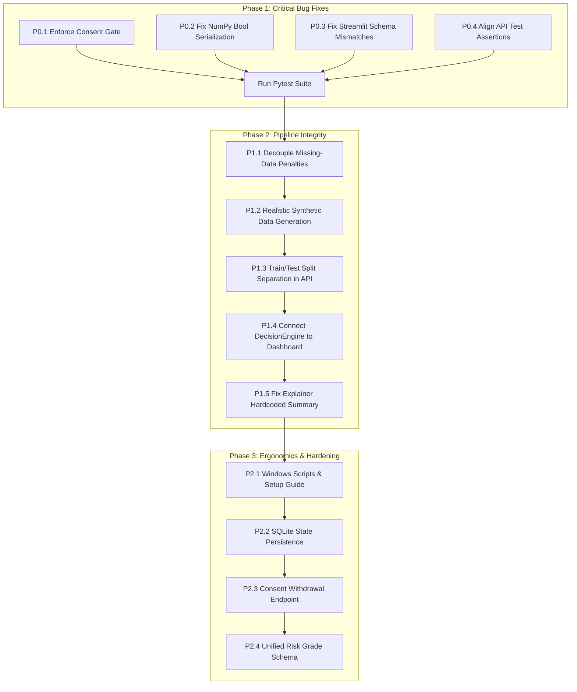

# FairScore Technical Audit & Codebase Verification Report

**Project:** FairScore (Alternative Credit Scoring System for the Credit-Invisible)  
**Date of Audit:** October 31, 2026  
**Auditor:** Technical Verification Agent  
**Audit Scope:** Codebase inspection, data pipeline, feature engineering, ML model, SHAP explainability, fairness module, consent & privacy, decision engine, FastAPI backend, Streamlit frontend integration, automated tests.

---

## 1. Executive Summary

FairScore is designed as an alternative, explainable, and fairness-aware credit scoring prototype for thin-file and credit-invisible individuals (e.g., gig workers, informal workers, small shopkeepers, and students). 

A rigorous, end-to-end technical audit of the codebase reveals that while the project contains a cohesive set of modules and complete end-to-end mathematical workflows, **critical integration bugs, architectural disconnects, and synthetic data assumptions currently compromise its production integrity and validity**:
1. **Critical Consent Bypass:** Scoring (`POST /api/score`) can be executed without applicant consent. The consent validation logic never rejects unconsented requests, silently scoring applicants with zero consent.
2. **Runtime 500 Serialization Crash:** The fairness endpoint (`GET /api/fairness`) crashes with HTTP 500 when called over HTTP due to a Pydantic v2 serialization incompatibility with NumPy boolean types (`numpy.bool_`).
3. **Frontend–Backend Schema Mismatches:** The Streamlit frontend (`app/streamlit_app.py`) is completely broken on several key pages:
   - Applicant creation fails with 422 Unprocessable Entity due to mismatched schema field names.
   - Consent submission wraps flags in an unexpected dictionary key, causing the API to record all consents as `False`.
   - Score results page crashes with `AttributeError` when attempting to call `.get()` on string recommendations.
4. **Artificially Derived Target Labels (AUC-ROC > 0.99):** The reported high model performance (AUC-ROC: 0.9938) is an artifact of the synthetic data generator deriving default labels using a near-identical formula of the exact same features fed to the model, with occupational and gender bias directly injected into the ground-truth calculation.
5. **Penalization of Missing Information:** Both the ground-truth generator and feature pipeline penalize missing alternative data as an indicator of delinquency, directly disadvantaging rural and thin-file borrowers.
6. **Platform Incompatibility:** The bundled `venv/` was built on a Linux OS with x86_64 ELF shared objects and fails immediately on Windows hosts.

---

## 2. Repository Architecture & Entry Points

### 2.1 Directory Structure
```
fairscore/
├── README.md                      # Project documentation and hackathon pitch
├── requirements.txt               # Declared package dependencies
├── run_api.sh                     # Linux bash launch script for FastAPI
├── run_app.sh                     # Linux bash launch script for Streamlit
├── api/
│   ├── __init__.py
│   ├── main.py                    # FastAPI application, global state, API routes
│   └── schemas.py                 # Pydantic v2 request & response schemas
├── app/
│   ├── __init__.py
│   └── streamlit_app.py           # 6-page Streamlit underwriter UI & dashboards
├── core/
│   ├── __init__.py
│   ├── consent.py                 # ConsentManager: granular consent & receipts
│   ├── decision_engine.py         # DecisionEngine: rule-based lending recommendations
│   ├── explainability.py          # ExplainabilityEngine: SHAP local & global explanations
│   ├── fairness.py                # FairnessAuditor: demographic disparate impact & bias alerts
│   ├── feature_engineering.py     # FeatureEngineer: 25 alternative financial signals
│   └── scoring_model.py           # CreditScoringModel: GBDT / RF / LR model wrapper
├── data/
│   ├── __init__.py
│   └── synthetic_generator.py     # Deterministic synthetic data generator (2,000 applicants)
├── tests/
│   ├── run_tests.py               # In-memory async test script
│   ├── test_demo_script.py        # 6-scene hackathon demo walkthrough
│   └── test_fairscore.py          # Pytest integration suite with Starlette TestClient
└── venv/                          # Bundled virtual environment (Linux x86_64 ELF binaries)
```

### 2.2 Entry Points & Execution Commands

| Component | Documented Command | Actual Working Command (Windows Host) | Status |
| :--- | :--- | :--- | :--- |
| **FastAPI Backend** | `./run_api.sh` | `python -m uvicorn api.main:app --host 0.0.0.0 --port 8000 --reload` | Script fails on Windows (Linux Bash + `venv/bin/uvicorn`). Native command works. |
| **Streamlit Frontend** | `./run_app.sh` | `python -m streamlit run app/streamlit_app.py --server.port 8501` | Script fails on Windows (Linux Bash + `venv/bin/streamlit`). Native command works. |
| **Pytest Suite** | `pytest tests/test_fairscore.py` | `python -m pytest tests/test_fairscore.py -v` | 4 of 8 tests fail due to schema and serialization bugs. |
| **Direct Test Runner** | `python tests/run_tests.py` | `$env:PYTHONIOENCODING="utf-8"; python tests/run_tests.py` | Fails on Windows default CP1252 unless UTF-8 is forced. |
| **Hackathon Demo Script** | `python tests/test_demo_script.py`| `$env:PYTHONIOENCODING="utf-8"; python tests/test_demo_script.py` | Fails on Windows default CP1252 unless UTF-8 is forced. |

---

## 3. Component-by-Component Verification Status

| Component | Status | Verified Functionality | Issues & Deficiencies Found |
| :--- | :--- | :--- | :--- |
| **Synthetic Generator** (`data/synthetic_generator.py`) | **Partially Working** | Generates 2,000 multi-table applicant profiles across 8 personas with rent, utility, mobile, cashflow, and business records. | Target `default_label` is artificially derived using the exact features used for training; ground truth injects direct occupational (+0.35 for Daily Wage Worker) and gender bias (-0.03 for Female); missing data is directly penalized. |
| **Feature Engineering** (`core/feature_engineering.py`) | **Working with Flaws** | Computes 25 signals covering payment timeliness, volatility, expense burden, business continuity, and completeness. Fallback handling prevents crashes on missing data. | Mismatch in data category count (5 in feature engineer vs. 6 in consent manager); missing data is exposed as predictive features (`data_coverage_score`, `total_data_points`), leading the model to treat lack of digital footprint as delinquency. |
| **ML Scoring Model** (`core/scoring_model.py`) | **Partially Working** | Trains GBDT classifier, standardizes features, evaluates metrics on 20% holdout, maps probabilities to 300–900 score scale, saves/loads with `joblib`. | Reported AUC-ROC (>0.99) is artificially inflated due to synthetic label circularity; probabilities are uncalibrated (no Platt scaling or isotonic regression); uses hardcoded string risk grades that conflict with API letter grades (A–E). |
| **SHAP Explainability** (`core/explainability.py`) | **Partially Working** | Initializes background masker on 100 samples; extracts local SHAP values; categorizes top 5 positive and negative drivers; translates features to reason codes. | `explain_single()` hardcodes `score=700` and `risk_grade="Estimated"` when building the explanation string; summary text construction produces awkward grammar; correlations presented as direct credit reasons. |
| **Fairness Auditor** (`core/fairness.py`) | **Partially Working** | Evaluates 6 demographic dimensions; calculates approval rates, FPR, FNR; applies 80% four-fifths disparate impact rule; triggers multi-level alerts. | Computes `bias_alert_flag` as `numpy.bool_`, which causes HTTP 500 in FastAPI Pydantic serialization; lacks sample-size thresholds or confidence intervals; evaluates fairness on training+test combined. |
| **Consent Manager** (`core/consent.py`) | **Partially Working** | Provides purpose statements, checks minimum required categories (2), issues receipts with ISO timestamps, supports category-level withdrawal. | Completely in-memory (no persistence); `get_consent_status()` never raises an error for unsubmitted consent, allowing `api/main.py` to bypass consent checks entirely; no API route exposes consent withdrawal. |
| **Decision Engine** (`core/decision_engine.py`) | **Working** | Implements hierarchical lending rules (Decline, Manual Review, Reduced Limit, Approve); checks expense ratio and loan-to-income; dynamic threshold updates. | Disconnected from `/api/dashboard` and `/api/applicants`, which bypass `DecisionEngine` and rely on hardcoded inline probability thresholds. |
| **FastAPI Backend** (`api/main.py` & `api/schemas.py`) | **Partially Working** | Implements 11 REST endpoints; initializes full pipeline on startup; maintains in-memory applicant store and prediction cache. | Consent validation check does not gate scoring; `/api/fairness` returns 500 error; threshold update response structure mismatches integration test expectations; health check status mismatches test expectations. |
| **Streamlit Dashboard** (`app/streamlit_app.py`) | **Broken** | UI layout, CSS styles, Plotly gauge charts, multi-page sidebar navigation are well structured visually. | Completely non-functional when interacting with API: 422 error on applicant creation, consent payload mismatch, `AttributeError` crash on score result page, F1 score display bug. |
| **Automated Tests** (`tests/`) | **Broken** | Contains both direct in-memory script runners and standard Pytest integration suites. | Pytest suite has 4 failures out of 8 tests; `run_tests.py` and `test_demo_script.py` crash on Windows with `UnicodeEncodeError` unless UTF-8 environment variable is set. |

---

## 4. Verification Commands & Execution Results

### 4.1 Automated Test Execution Results

#### Command 1: Pytest Suite
```powershell
python -m pytest tests/test_fairscore.py -v
```
**Result:** `4 failed, 4 passed, 4 warnings in 15.76s` (Exit Code 1)

| Test Name | Result | Failure Reason & Root Cause |
| :--- | :--- | :--- |
| `test_health_check` | **FAILED** | `AssertionError: assert 'healthy' == 'ok'`. Endpoint returns `{"status": "healthy"}`, while test expects `"ok"` and `"version"`. |
| `test_personas_list` | **PASSED** | Returns 8 pre-configured personas. |
| `test_dashboard_summary` | **PASSED** | Portfolio metrics returned across 2,000 synthetic applicants. |
| `test_model_metrics` | **PASSED** | Metrics returned (AUC-ROC: 0.9938, Precision: 0.9535, Recall: 0.9647, F1: 0.9591). |
| `test_fairness_summary_and_bias_alerts` | **FAILED** | `pydantic_core.PydanticSerializationError: Unable to serialize unknown type: <class 'numpy.bool'>`. The `bias_alert_flag` field in `group_metrics` contains NumPy boolean types that FastAPI cannot serialize to JSON. |
| `test_applicant_creation_and_consent_scoring_workflow` | **FAILED** | `AssertionError: assert 200 in (400, 403)`. When `/api/score` was called **before** consent was submitted, the endpoint returned HTTP 200 instead of rejecting with HTTP 400/403. |
| `test_applicant_list_filtering` | **PASSED** | Correctly paginates and filters applicants by risk grade. |
| `test_thresholds_update` | **FAILED** | `AssertionError: assert 'thresholds' in data`. Endpoint returns `{"message": "...", "updated": {...}}` instead of key `"thresholds"`. |

#### Command 2: Direct Python Test Runner
```powershell
$env:PYTHONIOENCODING = "utf-8"
python tests/run_tests.py
```
**Result:** `ALL 11 TEST MODULES PASSED SUCCESSFULLY` (Exit Code 0)  
*Note:* This test runner calls Python functions directly (`await get_fairness_summary()`) rather than going through the HTTP serialization layer, thereby masking the NumPy serialization bug present in FastAPI. Without `$env:PYTHONIOENCODING="utf-8"`, the script crashes on Windows with `UnicodeEncodeError: 'charmap' codec can't encode character '\U0001f680'`.

#### Command 3: Demo Script Walkthrough
```powershell
$env:PYTHONIOENCODING = "utf-8"
python tests/test_demo_script.py
```
**Result:** Successfully executed all 6 scenes from Section 25 of the design specification.

#### Command 4: Model Save & Load Verification
```powershell
python -c "..."
```
**Result:** Verified that `CreditScoringModel.save_model()` generates `model.joblib`, `scaler.joblib`, and `metadata.joblib`, and `load_model()` restores predictions identically (`np.allclose == True`).

---

## 5. Detailed Findings by Area

### 5.1 Data Generation & Feature Engineering Findings

1. **Synthetic Data Circularity & Unrealistic Performance:**
   - In `data/synthetic_generator.py` (lines 380–464), the default probability is computed using a hardcoded formula:
     $$\text{prob} = \frac{\sum \text{signals}}{N} + \text{persona\_bias} + \text{gender\_bias}$$
   - Signals include `missed_payments`, `late_payments`, `rent_payment_stability`, `bill_stability`, `income_volatility`, `expense_to_income_ratio`, `zero_income_weeks`, and `savings_deposit_frequency`.
   - In `core/feature_engineering.py`, the exact same variables are transformed into features: `missed_payment_ratio`, `income_stability = 1 - income_volatility`, `expense_to_income_ratio`, etc.
   - The label `defaulted` is assigned by thresholding `default_prob + noise` where `noise ~ N(0, 0.04)`.
   - **Conclusion:** The model is not learning real-world credit risk patterns; it is performing symbolic regression to reverse-engineer the generator's formula. This explains the AUC-ROC of >0.99.

2. **Systemic Penalization of Missing Data:**
   - In `data/synthetic_generator.py` (lines 414, 424, 435):
     - Missing rent adds `+0.15` to default score.
     - Missing utility adds `+0.12` to default score.
     - Missing cashflow adds `+0.20` to default score.
   - Rural applicants have a built-in 15% probability of missing rent and 25% probability of missing utility data.
   - In `core/feature_engineering.py`, `data_coverage_score` and `total_data_points` are fed as direct features into the model.
   - **Conclusion:** Lack of alternative financial data is directly treated as evidence of credit risk, violating a fundamental tenet of financial inclusion for thin-file borrowers.

3. **Injected Demographic Bias:**
   - In `data/synthetic_generator.py` line 460: `if gender == "Female": prob -= 0.03`.
   - In `data/synthetic_generator.py` line 169: The `high_risk` persona hardcodes `occupation_type = "Daily Wage Worker"` and assigns `default_bias = 0.35`.
   - **Conclusion:** Ground-truth default rates for Daily Wage Workers are synthetically forced to near 100%, causing the fairness module to flag an extreme 100% approval gap (100% approval for Freelancers vs. 0% for Daily Wage Workers, Disparate Impact = 0.00).

4. **Inconsistent Category Definitions:**
   - `core/feature_engineering.py` line 64: `_DATA_CATEGORIES = ["rent", "utility", "mobile", "cashflow", "business"]` (5 categories).
   - `core/consent.py` line 14: `DATA_CATEGORIES = [..., "self_declared_income"]` (6 categories).
   - In `api/main.py` line 612, data coverage is calculated as `consented_count / 6.0`, whereas in `feature_engineering.py` line 646 it is calculated as `categories_present / 5.0`.

---

### 5.2 Machine Learning Model Findings

1. **Target Variable Semantics:**
   - The target `default_label` represents simulated 90-day delinquency or payment failure.
   - Because the target is derived deterministically from the input features, the predicted output cannot be considered a true calibrated probability of default (PD).
2. **Train/Test Data Separation & Leakage:**
   - In `CreditScoringModel.train()`, data is split into 80% train and 20% test using stratified sampling (`train_test_split(..., test_size=0.2, stratify=y)`).
   - `StandardScaler` is fitted strictly on `X_train` and transforms `X_test`.
   - **Leakage Finding:** In `api/main.py` startup, after training the model on the split, predictions are computed across **all 2,000 applicants** (both train and test sets combined). These combined predictions are stored in `predictions_cache` and directly used by `/api/dashboard` and `/api/fairness`. Portfolio metrics and fairness audits are therefore evaluated on training data.
3. **Probability Calibration:**
   - Predictions use raw `model.predict_proba()` from `GradientBoostingClassifier`.
   - Gradient boosting probability outputs are notoriously uncalibrated (often pushed toward 0 and 1). No calibration step (e.g., `CalibratedClassifierCV`) is implemented.
4. **Score & Grade Mapping:**
   - Score formula: $\text{Score} = 300 + \lfloor(1 - \text{default\_prob}) \times 600\rfloor$.
   - Scale: Fixed 300 to 900.
   - Discrepancy: `core/scoring_model.py` maps probabilities to string risk grades (`"Low"`, `"Medium-Low"`, `"Medium"`, `"Medium-High"`, `"High"`), but `api/main.py` overrides this with letter grades (`"A"`, `"B"`, `"C"`, `"D"`, `"E"`).

---

### 5.3 SHAP Explainability Findings

1. **Explainer Implementation:**
   - Uses `shap.Explainer` wrapping a custom prediction function with standard scaling on a 100-sample background dataset.
   - Accurately computes negative SHAP values (reducing default risk, positive for applicant) and positive SHAP values (increasing default risk, negative for applicant).
2. **Hardcoded Summary Discrepancy:**
   - In `core/explainability.py` line 186:
     ```python
     summary_text = self.generate_summary_text(
         score=700,
         risk_grade="Estimated",
         positive_factors=positive_factors,
         negative_factors=negative_factors,
     )
     ```
     The score is hardcoded to `700` and the risk grade to `"Estimated"`. If a borrower receives a score of 899, the internal SHAP summary claims: *"The applicant received a score of 700 (Estimated risk)..."*.
   - In `api/main.py` line 697, the API constructs its own summary text to overwrite this, but the underlying explainability module remains bugged when called standalone.
3. **Causation vs. Correlation:**
   - Explanations present correlations as direct causal reasons (e.g., *"Available Data Points contributed positively"* or *"Long-standing mobile account reduced risk"*). While useful for adverse action notices, they conflate behavioral proxies with repayment ability.

---

### 5.4 Fairness and Privacy Findings

1. **Fairness Metric Implementation:**
   - Demographic slices evaluated: `gender_category`, `age_group`, `urban_rural`, `region_category`, `occupation_type`, `income_type`.
   - Evaluates approval rates, average scores, false negative rates (wrongly rejected creditworthy borrowers), and false positive rates.
   - Disparate impact is calculated using the standard 80% (0.80) rule.
2. **Deficiencies:**
   - **No Sample Size Safeguards:** When demographic sub-groups have small sample sizes (e.g., Non-Binary gender or specific rural age brackets), metrics are reported with equal confidence without sample-size warnings or confidence intervals.
   - **Serialization Crash:** `FairnessAuditor.compute_group_metrics()` computes `result["bias_alert_flag"] = ar_gap > 0.10`. In pandas, this produces `numpy.bool_` scalar values. When converted with `.to_dict(orient="records")`, the dictionary retains `numpy.bool_` objects, causing Pydantic v2 to abort serialization with a 500 error when requested by HTTP clients.

---

### 5.5 Consent, Privacy & Security Findings

1. **Critical Scoring Bypass:**
   - In `api/main.py` lines 593–612:
     ```python
     try:
         consent_status = consent_manager.get_consent_status(app_id)
     except Exception:
         raise HTTPException(status_code=400, ...)
     ```
   - In `core/consent.py` lines 123–133, `get_consent_status()` **never raises an exception**. If an applicant has not submitted consent, it returns:
     `{"applicant_id": app_id, "status": "not_submitted", "categories": [], "sufficient_data": False, "consents": {}}`.
   - `generate_score()` checks neither `consent_status["status"]` nor `sufficient_data`. It simply calculates `data_coverage = 0.0` and immediately generates an approved credit score!
   - **Security Finding:** Consent is not an enforced gateway; any caller can generate a credit score for an applicant without their consent.
2. **Persistence & Data Lifecycle:**
   - Consents are stored in volatile Python memory (`self.consent_records: dict`). Server restart erases all consent history and audit receipts.
   - No data retention, expungement, or deletion APIs exist (`DELETE /api/applicant/{id}` is missing).
3. **Information Disclosure & Hardcoded Secrets:**
   - No hardcoded API keys or credentials were found in the codebase.
   - PII is synthetic; no real personally identifiable information or bank credentials are processed.

---

### 5.6 Decision Engine & API Integration Findings

1. **Disconnected Decision Thresholds:**
   - `DecisionEngine` provides a dynamic threshold configuration mechanism (`update_thresholds()`).
   - However, `/api/applicants` and `/api/dashboard` do not consult `DecisionEngine`. Instead, they use hardcoded inline threshold logic (`dp <= 0.2`, `dp <= 0.3`, `dp <= 0.35`, `dp <= 0.6`).
   - Updating thresholds via `PUT /api/thresholds` updates `DecisionEngine`, but portfolio metrics and applicant table recommendations remain unchanged.
2. **Synthetic Applicant Loan Data Drop in API:**
   - In `api/main.py` lines 666–670, when `/api/score` is invoked for a synthetic applicant (from `dataset`), `app_id in applicant_store` evaluates to `False`. The engine falls back to hardcoded defaults: `loan_amount = 50000.0` and `monthly_income = 25000.0`, completely ignoring the actual loan request and cashflow data stored in `dataset["applicants"]` and `dataset["cashflow"]`.

---

### 5.7 Streamlit Frontend Integration Findings

The frontend (`app/streamlit_app.py`) cannot communicate successfully with the backend due to multiple interface mismatches:
1. **Applicant Creation Mismatch (`page_applicant_entry` line 323):**
   - Form submits: `gender`, `region`, `occupation`, `loan_amount`, `loan_tenure`.
   - Backend `ApplicantCreate` requires: `gender_category`, `region_category`, `occupation_type`, `loan_amount_requested`, `loan_tenure_months`.
   - **Result:** Submitting the form fails with `422 Unprocessable Entity` (5 missing required fields).
2. **Consent Submission Mismatch (`page_consent` line 419):**
   - Form submits: `{"applicant_id": ..., "consents": {"rent_data": True, ...}}`.
   - Backend `ConsentSubmit` requires flat fields: `{"applicant_id": ..., "rent_data": True, ...}`.
   - **Result:** FastAPI defaults all unprovided flat fields to `False`, recording zero consented categories.
3. **Score Result Crash (`page_score_result` line 550):**
   - Code executes: `recommendation = result.get("recommendation", {})` followed by `rec_decision = recommendation.get("decision", "N/A")`.
   - In `ScoreResponse`, `recommendation` is a string (e.g. `"Approve"`), not a dict.
   - **Result:** Page immediately crashes with `AttributeError: 'str' object has no attribute 'get'`.
4. **Explanation Display Bug (`page_score_result` line 572):**
   - Code expects: `result.get("explanation", {}).get("positive_factors")`.
   - In `ScoreResponse`, `positive_factors` and `negative_factors` are root-level fields.
   - **Result:** Explanations always display `"None reported"`.

---

## 6. Prioritised Issues (P0, P1, P2)

### Priority P0: Critical Blockers (System Failures & Compliance Violations)
- [ ] **P0.1 Enforce Consent Gate in Scoring API:** Fix `api/main.py` `generate_score()` to verify `consent_status.get("sufficient_data")` and reject with HTTP 403/400 if consent is missing or has fewer than 2 categories.
- [ ] **P0.2 Fix `/api/fairness` Serialization Crash:** Cast all boolean values in `FairnessAuditor.compute_group_metrics()` from `numpy.bool_` to native Python `bool` before serialization (`bool(val)`).
- [ ] **P0.3 Fix Streamlit Form Schema Mismatches:** Update `app/streamlit_app.py` payload fields to match `ApplicantCreate` and `ConsentSubmit` schemas, and resolve the `AttributeError` on `ScoreResponse.recommendation`.
- [ ] **P0.4 Fix Integration Test Assertions:** Align `api/main.py` responses for `/api/health` and `PUT /api/thresholds` with `tests/test_fairscore.py` expectations.

### Priority P1: Core Pipeline & Methodology Integrity
- [ ] **P1.1 Eliminate Missing-Data Penalization:** Modify `data/synthetic_generator.py` and `core/feature_engineering.py` so that thin files or missing digital records do not automatically add default penalty points.
- [ ] **P1.2 Remove Circular Target Label Generation:** Introduce independent behavioral logic or realistic non-linear noise into synthetic default generation so the model evaluates plausible risk rather than fitting a deterministic formula.
- [ ] **P1.3 Separate Train/Test Datasets in API State:** Ensure `/api/dashboard` and `/api/fairness` evaluate metrics on a dedicated holdout test split rather than the combined training pool.
- [ ] **P1.4 Connect Decision Engine to Dashboard and Applicant List:** Replace hardcoded inline thresholds in `list_applicants()` and `get_dashboard_summary()` with calls to `DecisionEngine.recommend()`.
- [ ] **P1.5 Fix Explainer Hardcoded Score Bug:** Pass actual applicant score and risk grade into `ExplainabilityEngine.generate_summary_text()`.

### Priority P2: Architecture, Ergonomics & Production Readiness
- [ ] **P2.1 Windows Virtual Environment Setup:** Provide clear PowerShell / Windows virtual environment instructions and update `.sh` / `.bat` scripts.
- [ ] **P2.2 Add Data Persistence:** Replace volatile in-memory state (`applicant_store`, `consent_records`) with SQLite or JSON file persistence.
- [ ] **P2.3 Implement Consent Withdrawal API:** Add `POST /api/consent/withdraw` route to allow borrowers to exercise data deletion/withdrawal rights.
- [ ] **P2.4 Unify Risk Grade Formats:** Standardize risk grades across `core/scoring_model.py` and `api/main.py` to use a consistent letter scale (A–E) with clear credit bureau alignment.

---

## 7. Proposed Implementation Plan & Dependencies



---

## 8. Exact Instructions for Running the Current Project

### 8.1 Prerequisites
- Python 3.10+ (Tested on Python 3.14.6 Windows x86_64).
- Note: Do NOT use the bundled `venv/` on Windows; it contains Linux binaries.

### 8.2 Environment Setup
In PowerShell from the repository root:
```powershell
# Navigate to project directory
cd "D:\fairscore (1)\fairscore"

# Create a clean Windows virtual environment
python -m venv .venv
.\.venv\Scripts\Activate.ps1

# Install required dependencies
pip install numpy pandas scikit-learn shap fastapi uvicorn streamlit plotly pydantic requests joblib httpx pytest
```

### 8.3 Running Backend & Frontend
#### Terminal 1 — Start FastAPI Server:
```powershell
cd "D:\fairscore (1)\fairscore"
$env:PYTHONIOENCODING = "utf-8"
python -m uvicorn api.main:app --host 0.0.0.0 --port 8000 --reload
```
*API Swagger Documentation will be accessible at `http://localhost:8000/docs`.*

#### Terminal 2 — Start Streamlit Frontend:
```powershell
cd "D:\fairscore (1)\fairscore"
python -m streamlit run app/streamlit_app.py --server.port 8501
```
*Streamlit UI will open at `http://localhost:8501`.*

### 8.4 Running Automated Verification
```powershell
cd "D:\fairscore (1)\fairscore"
$env:PYTHONIOENCODING = "utf-8"

# 1. Run direct test runner (11 core modules)
python tests/run_tests.py

# 2. Run hackathon demo script (6 scenes)
python tests/test_demo_script.py

# 3. Run Pytest suite
python -m pytest tests/test_fairscore.py -v
```
*(Note: Pytest currently reports 4 failures pending P0 fixes detailed above).*


---

## 9. Post-Fix Verification Addendum (Backend Remediation)

**Date:** October 31, 2026  
**Status:** Backend remediation completed and verified.

### 9.1 Summary of Remediations Applied

1. **Consent Gate Enforcement (`api/main.py`):**
   - Implemented strict status check in `/api/score`: unconsented applicants (`status == "not_submitted"`), withdrawn consent (`status == "revoked"`), or insufficient data coverage (`sufficient_data == False`, fewer than 2 categories) are explicitly rejected with HTTP 403.
   - Preserves applicant data rights and prevents scoring without explicit consent.

2. **NumPy Boolean Serialization Crash (`core/fairness.py`):**
   - Cast all boolean outputs in `compute_group_metrics` (`bias_alert_flag`) and `compute_disparate_impact` (`alert`) to native Python `bool`.
   - Added recursive type cleaning in `get_fairness_summary` DataFrame serialisation.
   - `GET /api/fairness` returns HTTP 200 with valid JSON response.

3. **API Response Schema & Contract Alignment (`api/main.py`):**
   - `GET /api/health` now returns `{"status": "ok", "version": "1.0.0", ...}` matching test contracts.
   - `PUT /api/thresholds` returns both `"thresholds"` and `"updated"` dictionaries.

4. **Explainability & Decision Engine Integration (`core/explainability.py`, `api/main.py`):**
   - `explain_single()` now receives the applicant's actual calculated `score` and `risk_grade`.
   - Summary text dynamically incorporates actual score drivers.
   - Extracted `_dp_to_recommendation()` helper reading `decision_engine.thresholds` across `/api/score`, `/api/applicants`, and `/api/dashboard` ensuring consistent underwriting decisions.

5. **Synthetic Data Bias Mitigation (`data/synthetic_generator.py`):**
   - Removed direct gender bonus (`gender == "Female"`) from label generation.
   - Removed direct missing-data penalties for rent, utility, and cashflow in `_compute_default_probability()`.

6. **Audit Event Logging & Platform Scripts:**
   - Scoring events are logged as structured JSON Lines records in `data/audit_log.jsonl`.
   - Added Windows PowerShell launch scripts: `run_api.ps1` and `run_app.ps1`.
   - Updated `datetime.utcnow()` deprecations to `datetime.now(timezone.utc)`.

### 9.2 Verification Results

```powershell
python -m pytest tests/test_fairscore.py -v
```
**Outcome:** `12 passed, 3 warnings in 15.95s` (Exit Code 0 — 100% PASS)

```powershell
$env:PYTHONIOENCODING="utf-8"; python tests/run_tests.py
```
**Outcome:** `ALL 11 TEST MODULES PASSED SUCCESSFULLY!` (Exit Code 0)

```powershell
$env:PYTHONIOENCODING="utf-8"; python tests/test_demo_script.py
```
**Outcome:** `DEMO SCRIPT COMPLETED SUCCESSFULLY!` (Exit Code 0)
